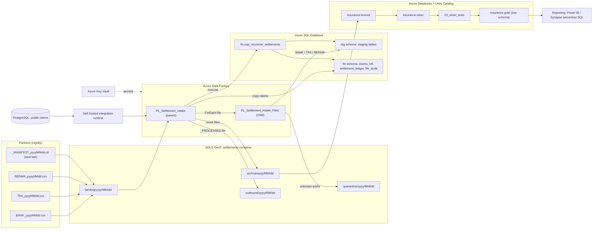
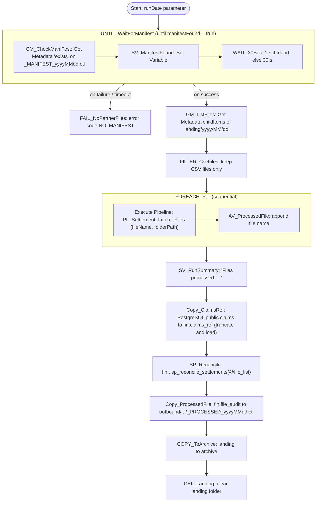
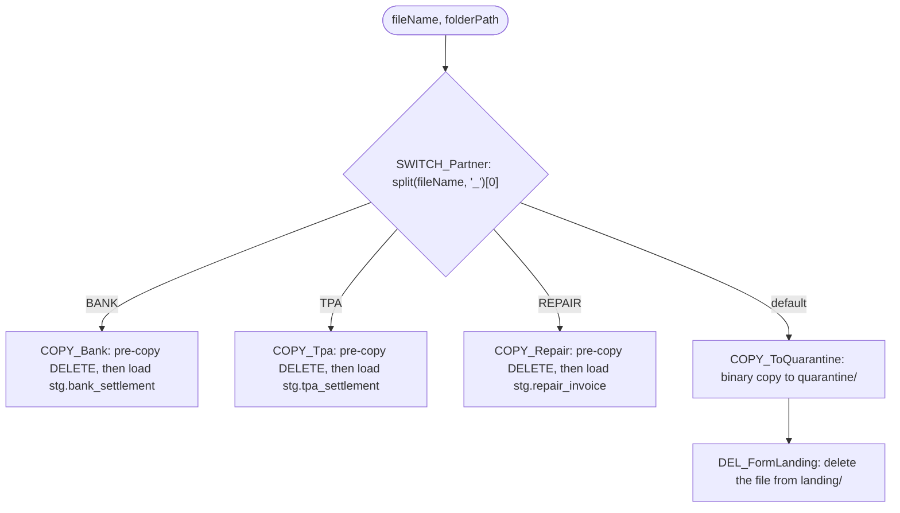
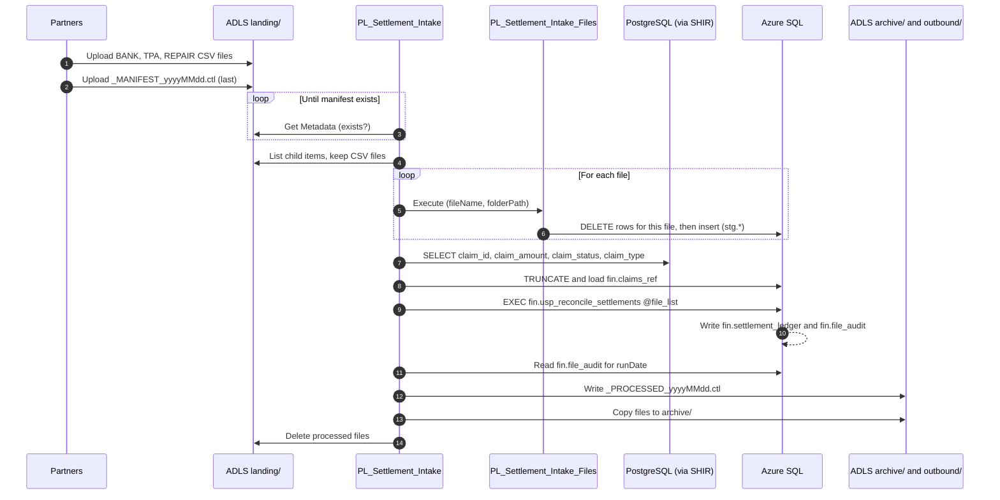
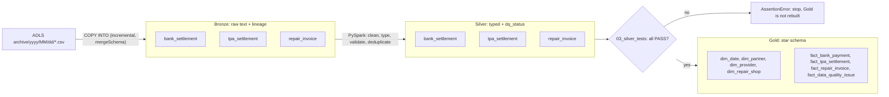
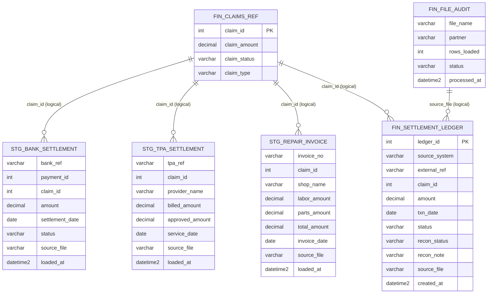
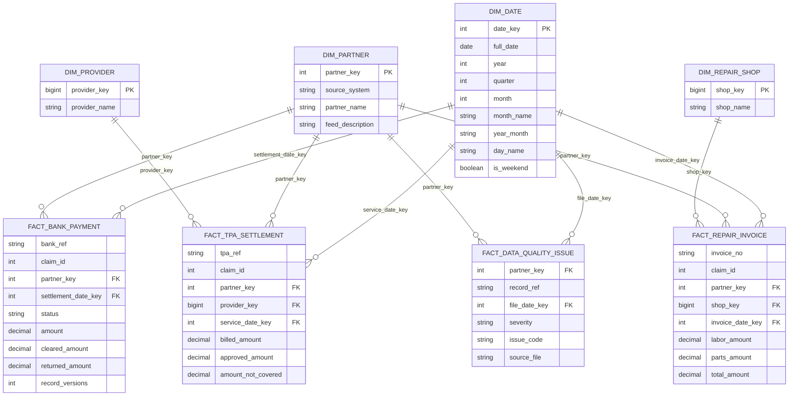
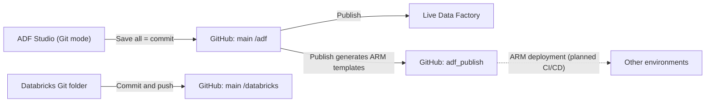

<div align="center">

# Azure Insurance Lakehouse
### Partner Settlement File Intake, Reconciliation and Medallion Lakehouse on Azure

An end-to-end **Azure data engineering** project. It ingests nightly settlement files from insurance partners, reconciles them against claims in **Azure SQL Database**, and builds a tested **Bronze → Silver → Gold** lakehouse with a **star schema** on **Azure Databricks** (Delta Lake and Unity Catalog).


</div>

---

## Table of Contents

1. [Project Overview](#1-project-overview)
2. [Key Features](#2-key-features)
3. [Technology Stack](#3-technology-stack)
4. [System Architecture](#4-system-architecture)
5. [Architecture and Data Flow Diagrams](#5-architecture-and-data-flow-diagrams)
6. [Repository Structure](#6-repository-structure)
7. [Technical Implementation](#7-technical-implementation)
8. [Database Architecture](#8-database-architecture)
9. [Integration Interfaces](#9-integration-interfaces)
10. [Prerequisites](#10-prerequisites)
11. [Installation and Setup](#11-installation-and-setup)
12. [Environment Configuration](#12-environment-configuration)
13. [How to Run the Project](#13-how-to-run-the-project)
14. [Testing](#14-testing)
15. [Deployment Architecture](#15-deployment-architecture)
16. [Troubleshooting](#16-troubleshooting)
17. [Performance and Optimization](#17-performance-and-optimization)
18. [Security Considerations](#18-security-considerations)
19. [Contribution Guidelines](#19-contribution-guidelines)
20. [Future Improvements](#20-future-improvements)
21. [About the Developer](#21-about-the-developer)
22. [References](#22-references)

---

## 1. Project Overview

### What is this project?

A batch data platform for a fictional insurer, **SecureShield Insurance**. The insurer does not pay claims directly. Three outside partners handle that work and send a settlement file every night:

| Partner | File | Contents |
|---|---|---|
| Bank | `BANK_yyyyMMdd.csv` | Claim payments that cleared or were returned |
| Third-party administrator (TPA) | `TPA_yyyyMMdd.csv` | Medical claim settlements (billed and approved amounts) |
| Auto repair shops | `REPAIR_yyyyMMdd.csv` | Repair invoices (labor, parts, total) |
| Partner gateway | `_MANIFEST_yyyyMMdd.ctl` | Control file, sent **last**. Lists every file and its row count |

Any other file, for example `SALVAGE_yyyyMMdd.csv`, comes from a partner without an agreed feed and must be quarantined.

### Why was it built, and what problem does it solve?

Finance needs a reconciliation report every morning that answers these questions:

- Which payments cleared, and which were returned?
- Does every partner record match a real claim, and is its amount within the claim amount?
- Which records are duplicates, invalid, or have no matching claim?
- Has any file been processed twice?

Partner files are often messy. Values arrive with currency symbols (`$1,250.50`), mixed case (`cleared`, `Cleared `), several date formats (`2026-10-11`, `10/11/2026`, `11-Oct-2026`), `N/A` placeholders, duplicate rows, and later corrections of earlier records. This project turns those files into trusted, reconciled and analytics-ready data.

### Primary objectives

1. **Reliable intake.** Start processing only when the delivery is complete (the manifest has arrived), and route each file to the right place.
2. **Re-runnable loads.** Running the pipeline again for the same day must never create duplicate rows.
3. **Reconciliation.** Match every partner record against claims and classify the result.
4. **Data quality.** Clean and standardize the data, and flag bad rows instead of silently dropping them.
5. **Analytics.** Publish a star schema for reporting tools.

### Main use cases

- Nightly automated intake of partner files into Azure SQL staging tables.
- Reconciliation of partner settlements against the claims system (PostgreSQL).
- Data quality monitoring per partner, per file and per issue type.
- Reporting on cleared vs returned payments, TPA approval rates, and repair invoice totals.

---

## 2. Key Features

| Area | Feature | Where |
|---|---|---|
| Orchestration | Manifest-driven start: an `Until` loop polls for the control file, then a `Fail` activity raises `NO_MANIFEST` if it never arrives | `adf/pipeline/PL_Settlement_Intake.json` |
| Orchestration | Parent/child pipeline pattern: `ForEach` calls a child pipeline once per file | `PL_Settlement_Intake` → `PL_Settlement_Intake_Files` |
| Routing | `Switch` on the file prefix (`BANK`, `TPA`, `REPAIR`); unknown files go to `quarantine/` | `adf/pipeline/PL_Settlement_Intake_Files.json` |
| Idempotency | Pre-copy `DELETE ... WHERE source_file = '<file>'` before each load | Child pipeline sinks |
| Lineage | `source_file` column added at copy time; `_source_file` and `_ingested_at` in Bronze | ADF additional columns, `01_bronze` |
| Hybrid connectivity | Claims copied from an on-premises PostgreSQL through a **self-hosted integration runtime** | `adf/integrationRuntime/SHIR-LOCAL-Postgres.json` |
| Reconciliation | Stored procedure `fin.usp_reconcile_settlements` called with the list of processed files | `SP_Reconcile` activity |
| File lifecycle | Outbound `_PROCESSED_yyyyMMdd.ctl`, copy to `archive/`, delete from `landing/` | End of `PL_Settlement_Intake` |
| Incremental ingest | `COPY INTO` loads only files not loaded before | `databricks/01_bronze.ipynb` |
| Data quality | Reusable PySpark cleaning functions, `dq_errors` / `dq_warnings` arrays, `VALID` / `INVALID` status | `databricks/02_silver.ipynb` |
| Deduplication | Window function keeps the latest version per business key and counts versions | `keep_latest()` in `02_silver` |
| Automated tests | Bronze vs Silver test suite with a PASS/FAIL report; fails the job on any failed test | `databricks/03_silver_tests.ipynb` |
| Dimensional model | Star schema with 4 dimensions and 4 facts, hash surrogate keys, Unknown (`-1`) members | `databricks/04_gold.ipynb` |
| Secrets | Database passwords read from **Azure Key Vault** at runtime | `adf/linkedService/*.json` |
| CI-ready | Factory resources versioned in Git; `adf_publish` branch configured for ARM templates | `adf/publish_config.json` |

---

## 3. Technology Stack

| Layer | Technology | Used for |
|---|---|---|
| Orchestration | **Azure Data Factory** (pipelines, datasets, linked services, expressions) | File intake, routing, copy, stored procedure calls, archiving |
| Storage | **Azure Data Lake Storage Gen2** (hierarchical namespace, `abfss://`) | `landing`, `archive`, `quarantine`, `outbound` folders and the lakehouse |
| Relational DB (cloud) | **Azure SQL Database** (T-SQL) | Staging (`stg`) and finance (`fin`) schemas, reconciliation procedure |
| Relational DB (source) | **PostgreSQL** | Claims system of record (`public.claims`) |
| Hybrid connectivity | **Self-hosted integration runtime** | Secure access from ADF to the local PostgreSQL server |
| Processing | **Azure Databricks**, **PySpark**, **Spark SQL** | Bronze, Silver and Gold layers |
| Table format | **Delta Lake** | ACID tables, schema evolution, `COPY INTO` |
| Governance | **Unity Catalog** | `insurance` catalog with `bronze`, `silver` and `gold` schemas; external locations |
| Secrets | **Azure Key Vault** | Database passwords referenced by ADF linked services |
| Serverless compute | **Azure Functions** | Claim risk scoring called from an ADF pipeline (supporting pipeline) |
| Source control | **GitHub** + ADF Git integration + Databricks Git folders | Version history for pipelines and notebooks |

**Languages:** Python (PySpark), Spark SQL, T-SQL, PostgreSQL SQL, ADF expression language, JSON.

---

## 4. System Architecture

The platform has two connected halves.

1. **Intake and reconciliation (Azure Data Factory + Azure SQL).** ADF waits for the partner manifest, loads each partner file into an Azure SQL staging table, copies the claims from PostgreSQL, runs the reconciliation stored procedure, writes an outbound control file, and archives the processed files.
2. **Lakehouse (Azure Databricks + Delta Lake).** Databricks reads the archived files into Bronze, cleans and validates them in Silver, tests Silver against Bronze, and publishes a star schema in Gold for reporting.



### Component responsibilities

| Component | Responsibility | Talks to |
|---|---|---|
| `PL_Settlement_Intake` | Parent pipeline. Waits for the manifest, lists and filters files, loops over them, refreshes claims, reconciles, writes the outbound file, archives | ADLS Gen2, child pipeline, PostgreSQL (via SHIR), Azure SQL |
| `PL_Settlement_Intake_Files` | Child pipeline. Routes one file by its prefix and loads it, or quarantines it | ADLS Gen2, Azure SQL `stg` |
| `fin.usp_reconcile_settlements` | Classifies each staged record and writes the ledger and file audit | `stg.*`, `fin.claims_ref`, `fin.settlement_ledger`, `fin.file_audit` |
| `00_setup` | Creates the Unity Catalog catalog and schemas | Unity Catalog |
| `01_bronze` | Loads archived CSVs into Bronze Delta tables with `COPY INTO` | ADLS `archive/`, `insurance.bronze` |
| `02_silver` | Cleans, types, validates and deduplicates | `insurance.bronze` → `insurance.silver` |
| `03_silver_tests` | Proves Silver is complete and correct; stops on failure | `insurance.bronze`, `insurance.silver` |
| `04_gold` | Builds the star schema as external Delta tables | `insurance.silver` → `insurance.gold` |
| Key Vault | Stores the Azure SQL and PostgreSQL passwords | ADF linked services |

---

## 5. Architecture and Data Flow Diagrams

### 5.1 Parent pipeline: `PL_Settlement_Intake`



### 5.2 Child pipeline: `PL_Settlement_Intake_Files`



### 5.3 Nightly run: sequence



### 5.4 Medallion lakehouse flow



### 5.5 ADLS Gen2 folder layout

```text
settlements/                        container
├── landing/yyyy/MM/dd/             new partner files (partners write only here)
├── quarantine/yyyy/MM/dd/          files from unknown partners, for review
├── archive/yyyy/MM/dd/             processed files (read by Databricks Bronze)
└── outbound/yyyy/MM/dd/            _PROCESSED_yyyyMMdd.ctl for downstream teams

lakehouse/                          container used by Unity Catalog
├── insurance/                      managed storage for the insurance catalog
└── gold/<table>/                   external Delta tables for the star schema
```

---

## 6. Repository Structure

The repository is connected to **Azure Data Factory Git integration** (root folder `/adf`) and to a **Databricks Git folder** (`/databricks`). Changes saved in ADF Studio and committed from Databricks appear here directly.

```text
azure-insurance-lakehouse/
├── README.md
├── adf/                                   Azure Data Factory resources (JSON, generated by ADF Git integration)
│   ├── factory/
│   │   └── AdfInsurance1.json             Factory definition
│   ├── pipeline/
│   │   ├── PL_Settlement_Intake.json      Parent: manifest wait, loop, reconcile, archive
│   │   ├── PL_Settlement_Intake_Files.json  Child: Switch routing and staging loads
│   │   ├── PL_Claim_Incremetal.json       Supporting: watermark-based incremental copy
│   │   ├── PL_Bronze_ingention.json       Supporting: metadata-driven PostgreSQL export + Azure Function call
│   │   └── pl-insurace-ingestion.json     Supporting: first copy exercise (CSV to CSV)
│   ├── dataset/                           Parameterized datasets (ADLS binary/CSV, Azure SQL, PostgreSQL, Parquet)
│   ├── linkedService/                     Connections (ADLS Gen2, Azure SQL, PostgreSQL, Key Vault, Azure Function)
│   ├── integrationRuntime/
│   │   └── SHIR-LOCAL-Postgres.json       Self-hosted integration runtime for PostgreSQL
│   └── publish_config.json                Publish branch: adf_publish
└── databricks/                            Azure Databricks notebooks (run in this order)
    ├── 00_setup.ipynb                     Unity Catalog: catalog and schemas
    ├── 01_bronze.ipynb                    COPY INTO from archive/ into Bronze
    ├── 02_silver.ipynb                    PySpark cleaning, data quality and deduplication
    ├── 03_silver_tests.ipynb              Bronze vs Silver test suite (PASS/FAIL report)
    └── 04_gold.ipynb                      Star schema (dimensions and facts)
```

### Key datasets

| Dataset | Type | Parameters | Used for |
|---|---|---|---|
| `DS_ADLS_Folder` | Binary (ADLS Gen2) | `folderPath` | List files; copy and delete whole folders |
| `DS_ADLS_File_Binary` | Binary (ADLS Gen2) | `folderPath`, `fileName` | Check if the manifest exists; quarantine one file |
| `DS_ADLS_CSV` | DelimitedText, comma, header | `folderPath`, `fileName` | Read partner CSV files |
| `DS_ADLS_ControlFile` | DelimitedText, pipe | `folderPath`, `fileName` | Write the outbound `_PROCESSED` control file |
| `DS_AzureSQL_Table` | Azure SQL table | `schemaName`, `tableName` | Any staging or finance table |
| `DL_PostgreSql` | PostgreSQL table | `tableName` | Read `public.<table>` |
| `DS_Control_Table` | PostgreSQL | none | Queries against control and watermark tables |

---

## 7. Technical Implementation

### 7.1 Waiting for a complete delivery

Partners upload the manifest only after all data files, so the manifest's arrival means the delivery is complete. The pipeline does not depend on a fixed schedule.

```text
UNTIL_WaitForManifest   expression: @variables('manifestFound')
  GM_CheckManiFest      Get Metadata, field list: exists
                        fileName: @concat('_MANIFEST_', formatDateTime(<runDate or utcNow()>, 'yyyyMMdd'), '.ctl')
  SV_ManifestFound      @activity('GM_CheckManiFest').output.exists
  WAIT_30Sec            @if(variables('manifestFound'), 1, 30)
```

With `exists` in the field list, Get Metadata returns `true` or `false` instead of failing when the file is missing. If the `Until` loop times out, `FAIL_NoPartnerFiles` ends the run with error code `NO_MANIFEST`, which a monitoring alert can catch.

The run date falls back to the current date when it is empty, so the same pipeline works for scheduled and manual runs:

```text
@formatDateTime(if(empty(pipeline().parameters.runDate), utcNow(), pipeline().parameters.runDate), 'yyyy/MM/dd')
```

### 7.2 Routing and idempotent loads

The child pipeline reads the partner code from the file name and runs the matching branch:

```text
@split(pipeline().parameters.fileName, '_')[0]      -- BANK_20261011.csv  ->  BANK
```

Each copy adds the file name as a column and removes earlier rows for the same file first, so a re-run replaces rows instead of duplicating them:

```json
"source": {
  "type": "DelimitedTextSource",
  "additionalColumns": [
    { "name": "source_file", "value": "@pipeline().parameters.fileName" }
  ]
},
"sink": {
  "type": "AzureSqlSink",
  "preCopyScript": "DELETE FROM stg.bank_settlement WHERE source_file = '@{pipeline().parameters.fileName}'"
}
```

Files with an unknown prefix are moved to `quarantine/` with a binary copy followed by a delete. The target path is derived from the source path:

```text
@replace(pipeline().parameters.folderPath, 'landing/', 'quarantine/')
```

### 7.3 Reconciliation (Azure SQL)

`SP_Reconcile` calls `fin.usp_reconcile_settlements` with the comma-separated list of processed files (`@join(variables('processedFiles'), ',')`). The procedure:

1. Splits the list with `STRING_SPLIT` and derives the partner from each file name.
2. Deletes earlier ledger and audit rows for those files, which makes the step re-runnable.
3. Uses `ROW_NUMBER() OVER (PARTITION BY <reference> ORDER BY loaded_at)` to detect duplicates.
4. Left-joins each staged record to `fin.claims_ref` and writes one ledger row with a status:

| `recon_status` | Rule |
|---|---|
| `DUPLICATE` | The same reference appears more than once |
| `NO_CLAIM` | The claim ID does not exist in the claims data |
| `RETURNED` | The bank returned the payment |
| `INVALID` | TPA approved more than billed, or repair total ≠ labor + parts |
| `OVER_LIMIT` | The partner amount is higher than the claim amount |
| `MATCHED` | None of the above |

5. Writes one `fin.file_audit` row per file: `LOADED` with a row count, or `QUARANTINED`.

> The stored procedure and table DDL are deployed in the Azure SQL database. They are not yet stored in this repository. See [Future Improvements](#20-future-improvements).

### 7.4 Bronze: incremental, lineage-preserving ingest

Bronze keeps every row exactly as received, with all columns as text, and adds lineage columns. `COPY INTO` tracks which files it has loaded, so running it again loads only new files.

```sql
COPY INTO insurance.bronze.bank_settlement
FROM (
  SELECT *,
         _metadata.file_name   AS _source_file,
         current_timestamp()   AS _ingested_at
  FROM 'abfss://settlements@<storage-account>.dfs.core.windows.net/archive/'
)
FILEFORMAT = CSV
PATTERN = '*/*/*/BANK_*.csv'
FORMAT_OPTIONS ('header' = 'true', 'inferSchema' = 'false')
COPY_OPTIONS ('mergeSchema' = 'true');
```

### 7.5 Silver: reusable cleaning and data quality rules

The same rules apply to all three partners, so they are written once as PySpark functions:

```python
def to_amount(col_name):
    """Remove $, commas and spaces, then convert to DECIMAL(12,2). Invalid values become null."""
    return F.expr(f"try_cast(regexp_replace({col_name}, '[$, ]', '') AS DECIMAL(12,2))")

def to_date_multi(col_name):
    """Parse the date formats partners send: 2026-10-11, 10/11/2026, 11-Oct-2026."""
    c = f"trim({col_name})"
    return F.coalesce(
        F.expr(f"to_date(try_to_timestamp({c}, 'yyyy-MM-dd'))"),
        F.expr(f"to_date(try_to_timestamp({c}, 'MM/dd/yyyy'))"),
        F.expr(f"to_date(try_to_timestamp({c}, 'dd-MMM-yyyy'))"),
    )
```

`try_cast` and `try_to_timestamp` return null instead of failing, so one bad value such as `N/A` cannot stop the job. A cleaned copy of the raw text separates a **missing** value from a value that is **present but invalid**:

```python
bank = bank.withColumn("dq_errors", issue_list(
    (F.col("_amount_raw").isNull(),                               "MISSING_AMOUNT"),
    (F.col("_amount_raw").isNotNull() & F.col("amount").isNull(), "INVALID_AMOUNT"),
    (F.col("amount") < 0,                                         "NEGATIVE_AMOUNT"),
    (~F.col("status").isin(VALID_BANK_STATUS) | F.col("status").isNull(), "INVALID_STATUS"),
    # ...
))
```

Rows with errors are kept and marked `dq_status = 'INVALID'`. Warnings such as `UNKNOWN_PROVIDER`, `PARTS_AMOUNT_DERIVED` and `ZERO_AMOUNT_INVOICE` are recorded without invalidating the row.

**Business rules implemented**

| Partner | Rules |
|---|---|
| BANK | Required reference, claim, amount and date; amount ≥ 0; status in (`CLEARED`, `RETURNED`) |
| TPA | Required amounts; approved ≤ billed; no negative amounts; service date not after the file date; provider names standardized against a reference list |
| REPAIR | Total = labor + parts; no negative amounts; a missing parts amount is derived as total − labor and flagged |

**Deduplication and late corrections:** one row per business key is kept: the newest file first, then the row with the fewest errors. `record_versions` keeps the number of versions received.

```python
w = Window.partitionBy(key_col).orderBy(
    F.col("file_date").desc(), F.size("dq_errors").asc(), F.col("_ingested_at").desc())
```

For example, `BNK202610110003` was `CLEARED` on day 1 and `RETURNED` on day 2. Silver keeps `RETURNED` with `record_versions = 3`.

### 7.6 Gold: star schema

- `date_key` is an integer in `yyyyMMdd` format.
- `provider_key` and `shop_key` use `xxhash64(name)`, so the same name always gets the same key on every rebuild.
- `-1` is the **Unknown** member for missing values, so no fact row is lost in an inner join.
- Facts contain `VALID` Silver rows only. Errors and warnings go to `fact_data_quality_issue`.
- Tables are **external Delta tables** at `.../gold/<table>`, so other engines (for example Synapse serverless SQL) can read the files directly.

```sql
CREATE OR REPLACE TABLE insurance.gold.fact_bank_payment
LOCATION 'abfss://lakehouse@<storage-account>.dfs.core.windows.net/gold/fact_bank_payment'
AS
SELECT b.bank_ref, b.payment_id, b.claim_id, p.partner_key,
       COALESCE(CAST(date_format(b.settlement_date, 'yyyyMMdd') AS INT), -1) AS settlement_date_key,
       b.status, b.amount,
       CASE WHEN b.status = 'CLEARED'  THEN b.amount ELSE 0 END AS cleared_amount,
       CASE WHEN b.status = 'RETURNED' THEN b.amount ELSE 0 END AS returned_amount
FROM insurance.silver.bank_settlement b
JOIN insurance.gold.dim_partner p ON p.source_system = 'BANK'
WHERE b.dq_status = 'VALID';
```

### 7.7 Error handling summary

| Failure | Handling |
|---|---|
| Manifest never arrives | `Until` timeout → `FAIL_NoPartnerFiles` with error code `NO_MANIFEST` |
| Unknown partner file | Quarantined instead of loaded; recorded as `QUARANTINED` in `fin.file_audit` |
| Re-run for the same date | Pre-copy deletes and procedure-level deletes replace earlier rows |
| Bad values in a file | Converted to null and flagged in `dq_errors`; the row is kept for follow-up |
| Silver defect | `03_silver_tests` raises `AssertionError`, so a scheduled job stops before Gold |
| Archive copy fails | `DEL_Landing` runs only on success of `COPY_ToArchive`, so files are never deleted before they are archived |

<details>
<summary><b>Supporting pipelines (earlier exercises in <code>adf/pipeline</code>)</b></summary>

| Pipeline | Pattern demonstrated |
|---|---|
| `PL_Claim_Incremetal` | **Watermark-based incremental load** from PostgreSQL to Parquet: old/new watermark lookups, `If Condition` using `ticks()`, a copy window of `updated_at > old AND <= new`, a watermark update, and a run log in `pipeline_run_log` (`SUCCESS` or `NO_CHANGES`) |
| `PL_Bronze_ingention` | **Metadata-driven ingestion**: reads `public.pipeline_control` (active tables) and copies each table to Parquet; calls an **Azure Function** (`CheckClaimRisk`, POST) per claim and stores the risk level |
| `pl-insurace-ingestion` | Basic CSV-to-CSV copy between storage containers |

</details>

---

## 8. Database Architecture

### 8.1 Azure SQL Database: staging and finance

| Schema | Table | Purpose | Key |
|---|---|---|---|
| `stg` | `bank_settlement` | Bank rows as received, plus `source_file` and `loaded_at` | none (staging) |
| `stg` | `tpa_settlement` | TPA rows as received | none |
| `stg` | `repair_invoice` | Repair rows as received | none |
| `fin` | `claims_ref` | Copy of claims from PostgreSQL, refreshed each run | `claim_id` (PK) |
| `fin` | `settlement_ledger` | All partner records with reconciliation status and note | `ledger_id` (identity PK) |
| `fin` | `file_audit` | One row per processed file: rows loaded and status | none |

The ledger's unique constraint on `(source_system, external_ref)` is intentionally dropped so duplicates can be stored and flagged as `DUPLICATE`.



Relationships are **logical** (enforced by the reconciliation logic, not by foreign keys), because partner data can reference claims that do not exist. That case is exactly what the `NO_CLAIM` status reports.

### 8.2 PostgreSQL (source)

| Object | Used by | Purpose |
|---|---|---|
| `public.claims` | `Copy_ClaimsRef`, `PL_Claim_Incremetal` | Claims system of record (`claim_id`, `claim_amount`, `claim_status`, `claim_type`, `updated_at`) |
| `public.pipeline_control` | `PL_Bronze_ingention` | Metadata table listing active tables to export |
| `watermark_table` | `PL_Claim_Incremetal` | Last loaded `updated_at` per table |
| `pipeline_run_log` | `PL_Claim_Incremetal` | Audit of each incremental run |

### 8.3 Lakehouse: Unity Catalog `insurance`

| Schema | Tables | Notes |
|---|---|---|
| `bronze` | `bank_settlement`, `tpa_settlement`, `repair_invoice` | All columns text; `_source_file`, `_ingested_at` |
| `silver` | Same three tables | Typed columns, business columns, `dq_status`, `dq_errors[]`, `dq_warnings[]`, `record_versions` |
| `gold` | 4 dimensions, 4 facts | Star schema, external Delta tables |

**Gold star schema**



| Table | Grain (one row per) |
|---|---|
| `dim_date` | Calendar day, 2025-01-01 to 2027-12-31, plus Unknown |
| `dim_partner` | Partner feed (BANK, TPA, REPAIR) |
| `dim_provider` / `dim_repair_shop` | Provider / shop, plus Unknown |
| `fact_bank_payment` | Valid bank payment |
| `fact_tpa_settlement` | Valid TPA settlement |
| `fact_repair_invoice` | Valid repair invoice |
| `fact_data_quality_issue` | Error or warning on a Silver record |

---

## 9. Integration Interfaces

This project is batch data integration, not a REST service. It exposes no API of its own. Its interfaces are file contracts, a stored procedure, and one external function call.

### 9.1 Inbound file contract (partners → `landing/yyyy/MM/dd/`)

| File | Columns |
|---|---|
| `BANK_yyyyMMdd.csv` | `bank_ref, payment_id, claim_id, amount, settlement_date, status` |
| `TPA_yyyyMMdd.csv` | `tpa_ref, claim_id, provider_name, billed_amount, approved_amount, service_date` |
| `REPAIR_yyyyMMdd.csv` | `invoice_no, claim_id, shop_name, labor_amount, parts_amount, total_amount, invoice_date` |
| `_MANIFEST_yyyyMMdd.ctl` | One line per file: `file_name|row_count` |

All CSV files have a header row and use a comma delimiter.

### 9.2 Outbound control file (`outbound/yyyy/MM/dd/_PROCESSED_yyyyMMdd.ctl`)

Pipe-delimited, one line per file, produced from `fin.file_audit`:

```text
BANK_20261011.csv|25|LOADED
REPAIR_20261011.csv|15|LOADED
SALVAGE_20261011.csv|0|QUARANTINED
TPA_20261011.csv|20|LOADED
```

### 9.3 Stored procedure

| Item | Value |
|---|---|
| Name | `fin.usp_reconcile_settlements` |
| Parameter | `@file_list VARCHAR(MAX)`: comma-separated file names |
| Caller | ADF `SP_Reconcile` |
| Example | `EXEC fin.usp_reconcile_settlements @file_list = 'BANK_20261011.csv,TPA_20261011.csv,REPAIR_20261011.csv';` |
| Output | Rows in `fin.settlement_ledger` and `fin.file_audit` |

### 9.4 Azure Function (supporting pipeline)

`PL_Bronze_ingention` calls the function `CheckClaimRisk` with `POST` for each claim, through the linked service `LS_CheckClaimRisk`, and stores `output.riskLevel` in `claim_risk_results`. The function code is not part of this repository.

---

## 10. Prerequisites

| Requirement | Purpose |
|---|---|
| Azure subscription | All cloud resources |
| Azure Data Lake Storage Gen2 account (hierarchical namespace enabled) | Containers `settlements` and `lakehouse` |
| Azure Data Factory (V2) | Pipelines in `adf/` |
| Azure SQL Database | `stg` and `fin` schemas and the reconciliation procedure |
| Azure Key Vault | Secrets for Azure SQL and PostgreSQL |
| PostgreSQL with a `claims` table | Claims source |
| Self-hosted integration runtime (on the machine that can reach PostgreSQL) | PostgreSQL connectivity |
| Azure Databricks workspace (Premium) with Unity Catalog | Notebooks in `databricks/` |
| Databricks Access Connector + storage credential + external locations | Unity Catalog access to ADLS |
| GitHub account | Source control |
| SQL client (VS Code mssql extension, Azure Data Studio, DBeaver or pgAdmin) | Running DDL and checks |

---

## 11. Installation and Setup

> Replace every `<placeholder>` with your own names. Never commit real secrets.

**1. Clone the repository**

```bash
git clone https://github.com/kaustubhn36/azure-insurance-lakehouse.git
cd azure-insurance-lakehouse
```

**2. Storage.** In ADLS Gen2, create:
- container `settlements` with folders `landing/`, `archive/`, `quarantine/` (`outbound/` is created on the first run)
- container `lakehouse`

**3. Azure SQL Database.** Create the `stg` and `fin` schemas, the six tables in [section 8.1](#81-azure-sql-database-staging-and-finance), and `fin.usp_reconcile_settlements`. Allow Azure services to access the server.

**4. Key Vault.** Add the secrets referenced by the linked services and give the Data Factory managed identity permission to read secrets (the **Key Vault Secrets User** role).

**5. Self-hosted integration runtime.** Install it on the machine that can reach PostgreSQL, register it as `SHIR-LOCAL-Postgres`, and confirm it shows **Running**.

**6. Data Factory.** Connect the factory to this repository: **Manage → Git configuration → GitHub**, with collaboration branch `main`, publish branch `adf_publish`, root folder `/adf`. Update every linked service to point at your own resources, run **Test connection**, then **Publish**.

**7. Databricks.**
- Create a storage credential (Access Connector with the **Storage Blob Data Contributor** role on the storage account) and external locations for `abfss://settlements@<storage-account>.dfs.core.windows.net/` and `abfss://lakehouse@<storage-account>.dfs.core.windows.net/`.
- Add this repository as a **Git folder** (Workspace → Create → Git folder).
- Replace `<storage-account>` in the notebooks with your account name.
- Run `00_setup` once.

---

## 12. Environment Configuration

There is no `.env` file. Configuration lives in ADF linked services, Key Vault secrets, and notebook paths. The table below lists every value to set. A template:

```ini
# Azure resources (placeholders only - do not commit real values)
STORAGE_ACCOUNT=<storage-account>            # ADLS Gen2, containers: settlements, lakehouse
SQL_SERVER=<sql-server>.database.windows.net
SQL_DATABASE=<finance-database>
SQL_USER=<sql-admin-user>
KEY_VAULT_URL=https://<key-vault-name>.vault.azure.net/
POSTGRES_HOST=<postgres-host>
POSTGRES_DATABASE=<oltp-database>
POSTGRES_USER=<postgres-user>
SHIR_NAME=SHIR-LOCAL-Postgres
DATABRICKS_CATALOG=insurance

# Key Vault secret names (values live only in Key Vault)
SQL_PASSWORD_SECRET=<sql-password-secret-name>
POSTGRES_PASSWORD_SECRET=<postgres-password-secret-name>
```

| Where | Setting |
|---|---|
| `LS_CONN_GENK2` | ADLS Gen2 URL used by the settlement datasets |
| `LS_AzureSql_Finance` | Server, database, user; password from Key Vault |
| `LS_PostgreSql` | Host, port `5432`, database, user; password from Key Vault; runs on `SHIR-LOCAL-Postgres` |
| `LS_AzureKeyVault` | Key Vault base URL |
| Notebooks | `abfss://settlements@<storage-account>...` and `abfss://lakehouse@<storage-account>...` paths |
| `PL_Settlement_Intake` | Parameter `runDate` (`yyyy-MM-dd`); empty means today (UTC) |

---

## 13. How to Run the Project

### Step 1: Intake (Azure Data Factory)

1. Upload the partner files for a date to `settlements/landing/yyyy/MM/dd/`, and upload the manifest **last**.
2. Open `PL_Settlement_Intake` → **Debug**, and set `runDate`, for example `2026-10-11`.
3. To schedule it, add a schedule trigger that passes the run date:

```text
@formatDateTime(trigger().scheduledTime, 'yyyy-MM-dd')
```

**Check the results in Azure SQL**

```sql
SELECT file_name, partner, rows_loaded, status FROM fin.file_audit ORDER BY file_name;

SELECT source_system, recon_status, COUNT(*) AS cnt
FROM fin.settlement_ledger
GROUP BY source_system, recon_status
ORDER BY source_system, recon_status;
```

### Step 2: Lakehouse (Azure Databricks)

Run the notebooks in order: `00_setup` (once), `01_bronze`, `02_silver`, `03_silver_tests`, `04_gold`.

To automate them, create a Databricks job with four dependent tasks (`bronze → silver → silver_tests → gold`). If `silver_tests` fails, `gold` does not run.

**Check the results in Gold**

```sql
SELECT d.year_month,
       COUNT(*)               AS payments,
       SUM(f.cleared_amount)  AS cleared_amount,
       SUM(f.returned_amount) AS returned_amount
FROM insurance.gold.fact_bank_payment f
JOIN insurance.gold.dim_date d ON f.settlement_date_key = d.date_key
GROUP BY d.year_month;
```

---

## 14. Testing

### 14.1 Automated: `databricks/03_silver_tests.ipynb`

The notebook runs after `02_silver` and records every check as PASS or FAIL.

| Test group | What it proves |
|---|---|
| Completeness | Silver has one row per distinct Bronze key; no key lost or invented (`left_anti` joins); no duplicate or null keys |
| Versions | `record_versions` equals the number of Bronze rows per key, and the kept row comes from the newest file |
| Data types | Amounts are `decimal(12,2)`, IDs `int`, dates `date` |
| Value tracing | Every Silver amount equals the Bronze value from the same key and file, after cleaning |
| Data quality rules | `VALID` rows meet every rule, and `INVALID` rows have at least one error |
| Known scenarios | 20 named cases, for example `$1,250.50 → 1250.50`, `11-Oct-2026 → 2026-10-11`, status update kept as `RETURNED` |
| Expected counts | Row, valid and invalid counts for the sample data |

The last cell raises `AssertionError` when any test fails, so a scheduled job is marked as failed and Gold is not rebuilt from bad data.

**Expected results with the day 1 + day 2 sample data**

| Partner | Silver rows | Valid | Invalid |
|---|---|---|---|
| BANK | 37 | 31 | 6 |
| TPA | 29 | 24 | 5 |
| REPAIR | 23 | 21 | 2 |

### 14.2 Reconciliation checks in Gold (`04_gold.ipynb`)

| Check | Expected |
|---|---|
| Fact rows = Silver `VALID` rows | 31 / 24 / 21 |
| Fact amounts = Silver amounts | 50,317.27 / 58,418.66 / 52,702.97 |
| Orphan fact keys (`LEFT ANTI JOIN` to each dimension) | 0 for every relationship |
| Duplicate dimension keys | 0 for every dimension |

### 14.3 Pipeline tests (Azure Data Factory)

| Scenario | Expected |
|---|---|
| Manifest uploaded during the run | Loop continues until `exists = true`, then the run proceeds |
| No manifest for the date | Run fails with `Partner files not received for <date>` / `NO_MANIFEST` |
| Unknown partner file (`SALVAGE_*`) | Moved to `quarantine/`; `fin.file_audit` status `QUARANTINED` |
| Pipeline re-run for the same date | Staging row counts do not change (no duplicates) |

---

## 15. Deployment Architecture



- **Development:** ADF runs in Git mode. **Save all** commits JSON to `main` under `/adf`. Notebooks are committed from a Databricks Git folder under `/databricks`.
- **Release:** **Publish** deploys `main` to the live factory and writes ARM templates to the `adf_publish` branch (`publish_config.json`).
- **Promotion to other environments** using the ARM templates is a planned improvement. No CI/CD workflow exists in the repository yet.

---

## 16. Troubleshooting

| Symptom | Likely cause | Fix |
|---|---|---|
| `property 'firstRow' doesn't exist` | Lookup has **First row only** turned off | Turn it on, or use `output.value` |
| Manifest never found although it exists | Wrong `fileName` format, for example `yyyy/MM/dd` (creates folders) instead of `yyyyMMdd` | Use `'_MANIFEST_' + yyyyMMdd + '.ctl'` |
| `SqlFailedToConnect ... routing information, but timeout already expired` | Serverless Azure SQL resuming from auto-pause | Add activity retries (for example 3 × 60 s) and a longer connect timeout |
| `source_file` is NULL in staging | The column is not in the CSV | Add it under **Additional columns** in the copy source |
| External location error: *blob endpoint* | URL uses `.blob.core.windows.net` | Use `abfss://<container>@<account>.dfs.core.windows.net/` |
| `null values cannot be formatted as an SQL identifier` | Dynamic SQL built from an unset variable | Check variables before `format('%I', ...)` |
| Synapse cannot read a Gold table | Path points to managed storage, or deletion vectors are enabled | Use the external `gold/<table>` path; disable deletion vectors |
| Notebook cell stuck on *Waiting* | Cluster is starting | Wait for the cluster to show **Running** |
| `Error pushing changes` from a Databricks Git folder | Databricks GitHub app not installed on the repository, or wrong account linked | Install the app with repository access, or use a fine-grained token |

---

## 17. Performance and Optimization

Practices implemented in this repository:

- **Incremental Bronze ingest:** `COPY INTO` skips files that are already loaded, so re-runs do not rescan history.
- **Targeted deletes instead of full reloads:** staging pre-copy scripts delete only the rows for the file being reloaded.
- **Watermark incremental copy:** `PL_Claim_Incremetal` copies only rows changed between two watermarks, and skips the copy entirely when nothing changed (`If Condition` on `ticks()`).
- **Metadata-driven pipeline:** `PL_Bronze_ingention` adds tables through a control table instead of new activities.
- **Short-circuit wait:** the manifest loop waits 1 second once the file is found and 30 seconds otherwise.
- **Binary datasets** for move and delete operations, so files are not parsed when only their location matters.
- **Null-safe conversions** (`try_cast`, `try_to_timestamp`) so bad data never aborts a Spark job.
- **Deterministic hash keys** (`xxhash64`) for dimensions, so a full rebuild needs no lookup or sequence table.
- **Pre-split fact amounts** (`cleared_amount`, `returned_amount`), so report queries can sum directly without `CASE` logic.

---

## 18. Security Considerations

| Area | Practice |
|---|---|
| Secrets | Azure SQL and PostgreSQL passwords are **Azure Key Vault** references (`AzureKeyVaultSecret`). No password is stored in the repository |
| Storage credentials | ADLS linked services contain only ADF-encrypted credentials (`encryptedCredential`), which only this factory can decrypt |
| Lakehouse access | Unity Catalog storage credential (managed identity via Access Connector) and external locations. No account keys in notebooks |
| Least privilege | Data Factory managed identity reads secrets with **Key Vault Secrets User**; Access Connector uses **Storage Blob Data Contributor** |
| Network | Azure SQL uses `encrypt: mandatory`; PostgreSQL is reached through a self-hosted IR instead of being exposed to the internet |
| Data separation | Partners write only to `landing/`; unknown files are quarantined, never loaded |
| Public repository | This README uses placeholders for resource names. Sample data is synthetic |

**Recommended hardening** (not yet implemented):
- Move resource names (server, storage account, function URL) out of committed linked service JSON into ARM parameters for each environment.
- Use function-key or Microsoft Entra authentication for the Azure Function instead of anonymous access.
- Use managed identity authentication for Azure SQL instead of SQL authentication.

---

## 19. Contribution Guidelines

1. Fork the repository and create a feature branch: `git checkout -b feature/<short-name>`.
2. **ADF changes:** connect your factory to your fork in Git mode and use **Save all**. Do not edit the JSON by hand unless necessary.
3. **Notebook changes:** keep the existing structure: a markdown cell explaining **why** before each code cell, and run `03_silver_tests` before committing.
4. Never commit secrets, connection strings with passwords, tokens, or real customer data.
5. Use clear commit messages, for example `silver: flag negative approved_amount`.
6. Open a pull request describing the change, the test results, and any new data quality rules.

---

## 20. Future Improvements

These are **proposed** and not implemented yet:

- [ ] Add the Azure SQL DDL and `fin.usp_reconcile_settlements` to the repository (for example `sql/azure-sql/`) so the database is versioned with the pipelines.
- [ ] Add a Databricks Job activity at the end of `PL_Settlement_Intake` so one nightly run covers intake and lakehouse, and store the job definition (Databricks Asset Bundles).
- [ ] Add the nightly schedule trigger and failure alerts as versioned resources.
- [ ] Validate each file's row count against the manifest before loading.
- [ ] Make the CSV filter case-insensitive (for example `@endswith(toLower(item().name), '.csv')`) and align the `Until` timeout with the delivery window.
- [ ] Parameterize storage paths in the notebooks (widgets or job parameters) instead of fixed `abfss://` URLs.
- [ ] Move the provider reference list from the notebook into a reference Delta table.
- [ ] Use `MERGE` and Change Data Feed in Silver instead of a full rebuild as data grows.
- [ ] Add CI/CD with GitHub Actions: validate ADF resources, deploy ARM templates from `adf_publish`, and run the test notebook.
- [ ] Add a Power BI report on the Gold star schema.
- [ ] Fix typos in resource names (`PL_Claim_Incremetal`, `PL_Bronze_ingention`, `pl-insurace-ingestion`, `DEL_FormLanding`, the "Partener" fail message).

---

## 21. About the Developer

**Kaustubh Nandeshwar** works as a **Senior Database Developer**. His professional work centres on **PostgreSQL** stored function development and query optimization, **AWS** infrastructure, **OpenSearch/Elasticsearch**, and **Python** scripting. This repository is a hands-on project to extend that database background into **Azure data engineering**.

**Skills demonstrated in this repository**

| Skill | Evidence |
|---|---|
| SQL and database design | Staging/finance schemas, a set-based reconciliation procedure with window functions, a star schema with surrogate and Unknown keys |
| PostgreSQL integration | Claims extraction through a self-hosted IR, watermark tables, run logs, metadata-driven control table |
| ETL / ELT orchestration | Parent/child ADF pipelines, `Until` / `Switch` / `ForEach` / `Filter`, dynamic expressions, idempotent loads |
| Data processing | PySpark cleaning library, multi-format date parsing, deduplication with window functions |
| Data quality engineering | Error vs warning classification, lineage columns, quarantine flow, automated PASS/FAIL tests that stop the pipeline |
| Cloud platform | ADLS Gen2, Azure SQL, Key Vault, Azure Functions, Databricks with Unity Catalog and Delta Lake |
| Troubleshooting | Connectivity timeouts, Lookup output modes, storage endpoint formats, Git integration issues (see [Troubleshooting](#16-troubleshooting)) |
| Version control | ADF Git integration and Databricks Git folders on a shared repository |

**Connect:** [GitHub @kaustubhn36](https://github.com/kaustubhn36)

---

## 22. References

**Microsoft documentation**
- [Azure Data Factory: control flow activities](https://learn.microsoft.com/azure/data-factory/control-flow-until-activity)
- [Azure Data Factory: Git integration](https://learn.microsoft.com/azure/data-factory/source-control)
- [Self-hosted integration runtime](https://learn.microsoft.com/azure/data-factory/create-self-hosted-integration-runtime)
- [Azure Data Factory: credentials in Azure Key Vault](https://learn.microsoft.com/azure/data-factory/store-credentials-in-key-vault)
- [Azure Databricks: COPY INTO](https://learn.microsoft.com/azure/databricks/ingestion/cloud-object-storage/copy-into/)
- [Azure Databricks: Unity Catalog external locations](https://learn.microsoft.com/azure/databricks/connect/unity-catalog/cloud-storage/external-locations)
- [Delta Lake documentation](https://docs.delta.io/latest/index.html)
- [Medallion lakehouse architecture](https://learn.microsoft.com/azure/databricks/lakehouse/medallion)

**Project background**
- The business scenario (fictional **SecureShield Insurance**), lab structure and sample partner files come from a guided Azure data engineering training programme. The implementation in this repository was built and tested hands-on. All sample data is synthetic.

---

<div align="center">

**If this project helped you, consider giving it a ⭐**

</div>
